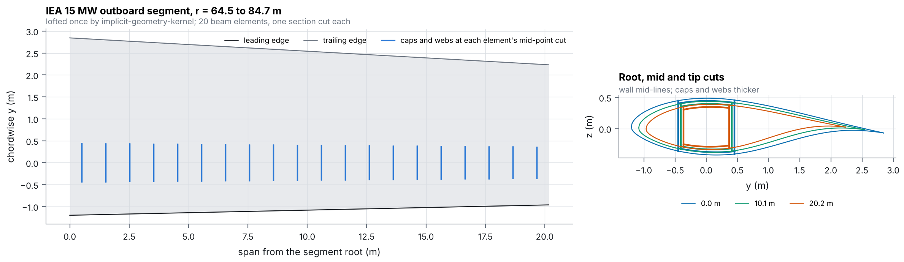
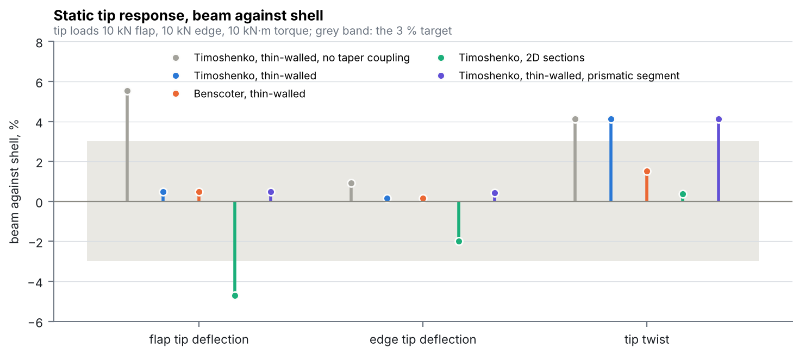
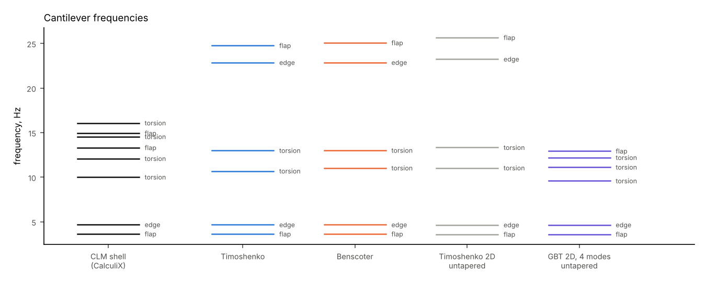
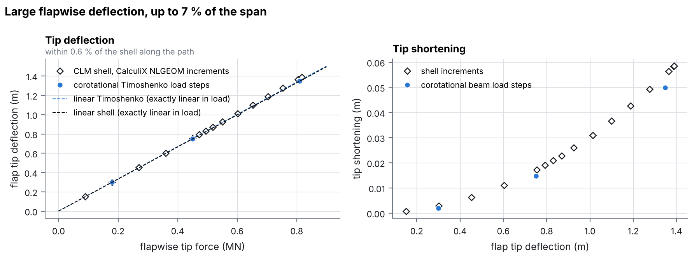

# A blade beam from an implicit-geometry-kernel loft

This example builds a 1d-fem beam of the outboard 20.2 m of the IEA Wind 15 MW blade
(r = 64.5 m to 84.7 m), directly from a loft, and checks it against a shell model of the
same loft.

The segment's chord runs from 4.07 m to 3.27 m and its twist from 1.5° to −0.4°
(`examples/iea15mw/segment.py`). implicit-geometry-kernel lofts it once.
`blade_beam_job` then writes the 1d-fem job: it cuts a section at every element
mid-point, and takes the reference axis, element frames, twist and pretwist from the loft.

```
python examples/blade_beam/run.py
```

It needs implicit-geometry-kernel (`pip install -r requirements-geometry.txt`, Python 3.11 or later). It takes about 40
minutes, mostly writing wall stresses, and writes the figures and `summary.json` here.
The shell results are committed in `data/shell_reference.json`. They come from
`make_shell_reference.py`, which needs composite-laminate-model and CalculiX:

- static runs of a composite-laminate-model shell blade (4360 curved `Quad8` elements);
- modal and `NLGEOM` runs of the same mesh in CalculiX.



## Static

The loads at the tip are 10 kN flapwise, 10 kN edgewise, or a 10 kN·m torque. The
cantilever has 20 elements. The 2D-section model meshes every element's section with
layered `Q8` elements.



| Beam against shell | Flap tip deflection | Edge tip deflection | Tip twist |
|---|---|---|---|
| Timoshenko, thin-walled | +0.5 % | +0.2 % | +4.1 % |
| Benscoter, thin-walled | +0.5 % | +0.2 % | +1.5 % |
| Timoshenko, thin-walled, no taper coupling | +5.5 % | +0.9 % | +4.1 % |
| Timoshenko, thin-walled, prismatic segment | +0.5 % | +0.4 % | +4.1 % |
| Timoshenko, 2D sections | −4.7 % | −2.0 % | +0.4 % |

- **Flap and edge agree within 0.5 % once the taper coupling is in.** `blade_beam_job`
  writes `section_taper.txt` from the change of each section along the element
  (`section_taper_from_geometry`). In a tapered blade the inclined caps carry part of
  the shear (the Resal effect); without that coupling the beam is 5.5 % soft in flap. On a
  prismatic segment, where there is no taper, the beam is within 0.5 % either way.
- **Torsion is 4 % soft with Timoshenko elements and 1.5 % soft with Benscoter** (the
  beam twists more than the shell). The 4 % stays on the prismatic segment and with the
  taper coupling, so it is not taper. Most of it is warping restraint at the clamp, which
  only Benscoter models. The remaining 1.5 % comes from the section idealisation and is not
  a missing beam effect:
  - On 2D sections, whose caps hold 6.5 % more carbon (GJ +4.5 % at 70 % span), the
    free-warping Timoshenko beam twists 0.4 % more than the shell.
  - A GBT beam on the same 2D sections, with the warping restrained at the clamp, twists
    3.4 % less than the shell. Adding 4 or 8 distortional modes (cross-section distortion,
    which the unstiffened shell allows) brings this to 1.8 % and 1.7 %. Distortion is
    therefore a real effect but a small one in statics, about 1.5 %. Because it softens the beam, it
    does not account for the thin-walled beams being soft.
  - These checks use untapered elements without pretwist (GBT sections do not take
    pretwist yet). The scripts are not part of the example.
- **The 2D sections are 2–5 % stiff in bending** because their caps hold 6.5 % more carbon
  than the thin-walled caps (see `post_processing/validation_visualisers/iea15mw_sections`).
  Before the taper coupling this cancelled the taper softening and the 2D model looked
  within 2 %.

## Modal



| Mode | Shell | Timoshenko | Benscoter | Timoshenko 2D, untapered | GBT 2D, 4 modes, untapered |
|---|---|---|---|---|---|
| 1 flap | 3.64 Hz | −0.3 % | −0.2 % | −1.3 % | −1.0 % |
| 2 edge | 4.68 Hz | −0.3 % | −0.3 % | −0.6 % | −0.5 % |
| 3 torsion | 10.02 Hz | +6.8 % | +10.2 % | +10.3 % | −4.2 % |
| 4 torsion with flap | 12.10 Hz | +7.4 % | +7.6 % | +10.3 % | −8.0 % |

Flap and edge agree within 0.3 % (they were 3.3 % and 0.8 % low before the taper coupling).

**Plane-section beams put the torsion modes 7 to 10 % high, and the gap is inertia.** A
4 % stiffness difference moves a frequency by about 2 %, and the Timoshenko beam on 2D
sections twists within 0.4 % of the shell under a static tip torque, yet its first torsion
frequency is 10 % high (11.05 Hz against 10.02 Hz). The shell's torsion mode moves its
sections out of their plane shape: about 10 % of the mode's in-plane kinetic energy is
distortion, mostly of the large unsupported trailing-edge panels.

**GBT on the 2D sections carries that inertia.** Its distortional modes (the sections' own
in-plane modes, `solid.cross_section_modes`) come with their mass, coupled with the
rotation (`gbt_mass`). Four modes take the first torsion frequency from +10.3 % to −4.2 %,
on the same untapered beam with the same static stiffness. Eight modes give 9.57 Hz
(−4.4 %), so four are converged. The GBT beam also gains the shell's denser set of
torsion-distortion modes between 11 and 13 Hz, which the plane-section beams do not have.
It now overshoots: the second torsion mode is 8 % low. Two things are not like for like
here:

- Both 2D beams here are untapered and unpretwisted, while the shell is tapered and
  twisted. GBT now takes both (its bases are aligned from section to section,
  `gbt_alignment`); with the modes held it gives the tapered, pretwisted Timoshenko 2D
  tip deflections within 0.3 % in flap and edge.
- GBT with the thin-walled sections' modes (not shown) leaves the first torsion frequency
  where the Timoshenko beam has it (10.66 Hz with 4 modes on 6 elements). The two mode
  sets are built differently (the thin-walled modes are orthogonal to the rigid-section
  modes in the warping stiffness, the 2D modes against the section area before they are
  decoupled from the beam strains), so they share the section rotation differently. Which
  is closer to the shell is open.

Above 13 Hz the shell has local panel modes that a beam cannot have, so only the first
four modes are compared.

## Large flapwise deflection

The corotational Timoshenko beam carries a flapwise tip force up to 0.81 MN, which
deflects the tip 1.41 m, or 7 % of the span.



The shell increments and beam load steps are shown as the discrete points they are; the
dashed lines are the linear solutions, which are exactly linear in the load.

- The beam stays within 0.6 % of the CalculiX `NLGEOM` shell all along the load path.
- Both models are close to linear at this deflection: the ratio to the linear solution is
  0.995 for the beam and 1.008 for the shell.
- The beam's tip shortening follows the shell's.

CalculiX stopped converging at 45 % of the planned 1.8 MN load, so the plan's check up to
15 % span deflection is not reached.

## Files

| | |
|---|---|
| `run.py` | builds and runs every job, compares and plots |
| `make_shell_reference.py` | the shell blade runs (composite-laminate-model, CalculiX) |
| `data/shell_reference.json` | shell results at the tip |
| `summary.json` | the beam results and the comparisons |
