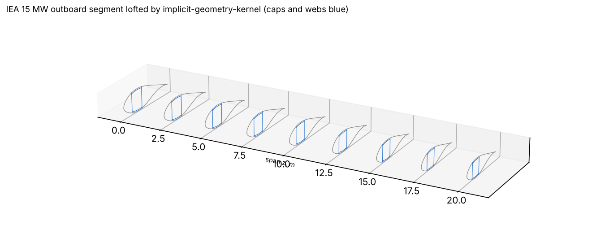
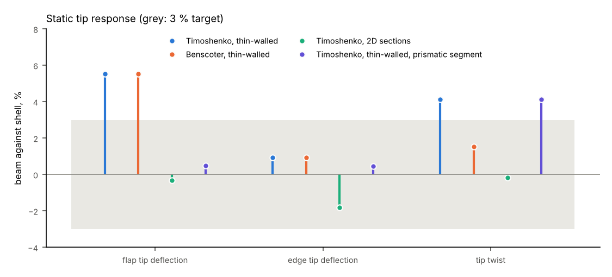
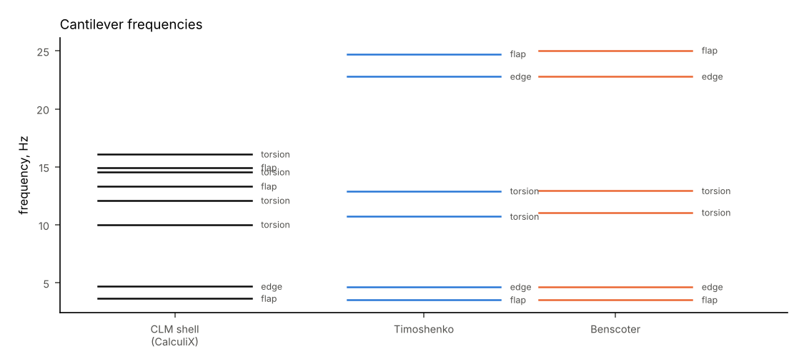
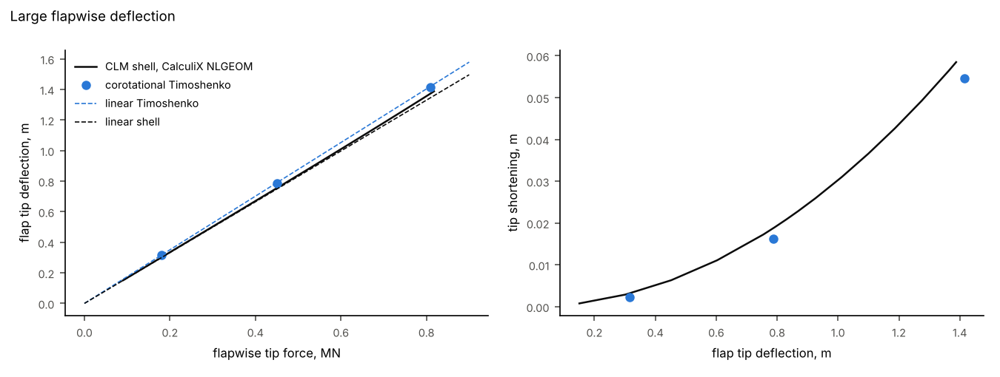

# A blade beam from an implicit-geometry-kernel loft

This example builds a 1d-fem beam of the outboard 20.2 m of the IEA Wind 15 MW blade
(r = 64.5 m to 84.7 m), directly from a loft, and checks it against a shell model of the
same loft.

The segment's chord runs from 4.07 m to 3.27 m and its twist from 1.5° to −0.4°
(`examples/iea15mw/segment.py`). implicit-geometry-kernel lofts it once.
`blade_beam_job` then writes the 1d-fem job: it cuts a section at every element
mid-point, and takes the reference axis, element frames, twist and pretwist from the loft.

```
python examples/blade_beam/run.py
```

It needs implicit-geometry-kernel (`pip install -e .[geometry]`). It takes about 25
minutes, mostly writing wall stresses, and writes the figures and `summary.json` here.
The shell results are committed in `data/shell_reference.json`. They come from
`make_shell_reference.py`, which needs composite-laminate-model and CalculiX:

- static runs of a composite-laminate-model shell blade (4360 curved `Quad8` elements);
- modal and `NLGEOM` runs of the same mesh in CalculiX.



## Static

The loads at the tip are 10 kN flapwise, 10 kN edgewise, or a 10 kN·m torque. The
cantilever has 20 elements. The 2D-section model meshes every element's section with
layered `Q8` elements.



| Beam against shell | Flap tip deflection | Edge tip deflection | Tip twist |
|---|---|---|---|
| Timoshenko, thin-walled | +5.5 % | +0.9 % | +4.1 % |
| Benscoter, thin-walled | +5.5 % | +0.9 % | +1.5 % |
| Timoshenko, 2D sections | −0.3 % | −1.8 % | −0.2 % |
| Timoshenko, thin-walled, prismatic segment | +0.5 % | +0.4 % | +4.1 % |

- **Flap on the tapered blade is 5.5 % soft, because of taper.** On a prismatic segment
  with the tip section all along, the same beam is within 0.5 %. The beam elements are
  prismatic. In a tapered blade the inclined caps carry part of the shear (the Resal
  effect), which the elements leave out.
- **Torsion is 4 % stiff with Timoshenko elements and 1.5 % with Benscoter.** The 4 %
  stays on the prismatic segment, so it is not taper. Most of it is warping restraint at
  the clamp, which only Benscoter models. The remaining 1.5 % is open.
- **The 2D sections agree within 2 % for a different reason.** Their caps hold 6.5 % more
  carbon than the thin-walled caps (see
  `post_processing/validation_visualisers/iea15mw_sections`). That stiffens them by about
  the amount the taper softens them, so the match is partly a cancellation.

## Modal



| Mode | Shell | Timoshenko | Benscoter |
|---|---|---|---|
| 1 flap | 3.64 Hz | −3.3 % | −3.2 % |
| 2 edge | 4.68 Hz | −0.8 % | −0.8 % |
| 3 torsion | 10.02 Hz | +6.9 % | +10.4 % |
| 4 torsion with flap | 12.10 Hz | +6.7 % | +6.9 % |

Flap and edge agree within the 3 % target, with flap low for the same taper reason as in
the static case. The torsion modes are 7 to 10 % high, which is more than the static
stiffness accounts for (a 4 % stiffness difference moves a frequency by about 2 %). The
rest is probably the polar mass inertia of the thin-walled section against the shell's
distributed mass, and is not yet explained.

Above 13 Hz the shell has local panel modes that a beam cannot have, so only the first
four modes are compared.

## Large flapwise deflection

The corotational Timoshenko beam carries a flapwise tip force up to 0.81 MN, which
deflects the tip 1.41 m, or 7 % of the span.



- The beam stays within 5 % of the CalculiX `NLGEOM` shell all along the load path. That
  is the same gap as in the linear flap case.
- Both models are close to linear at this deflection: the ratio to the linear solution is
  0.995 for the beam and 1.008 for the shell.
- The beam's tip shortening follows the shell's.

CalculiX stopped converging at 45 % of the planned 1.8 MN load, so the plan's check up to
15 % span deflection is not reached.

## Files

| | |
|---|---|
| `run.py` | builds and runs every job, compares and plots |
| `make_shell_reference.py` | the shell blade runs (composite-laminate-model, CalculiX) |
| `data/shell_reference.json` | shell results at the tip |
| `summary.json` | the beam results and the comparisons |
