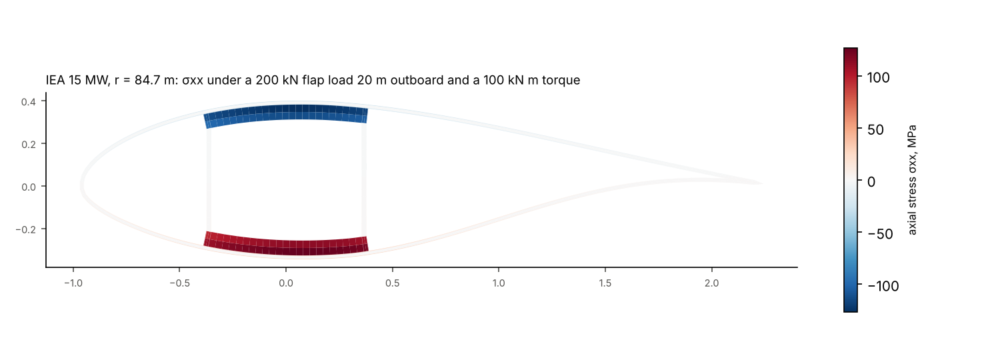
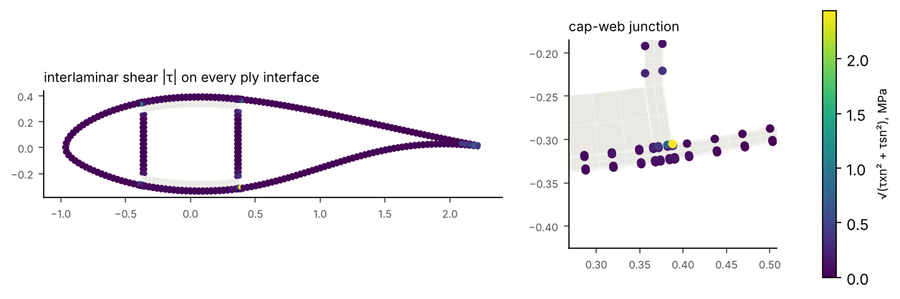
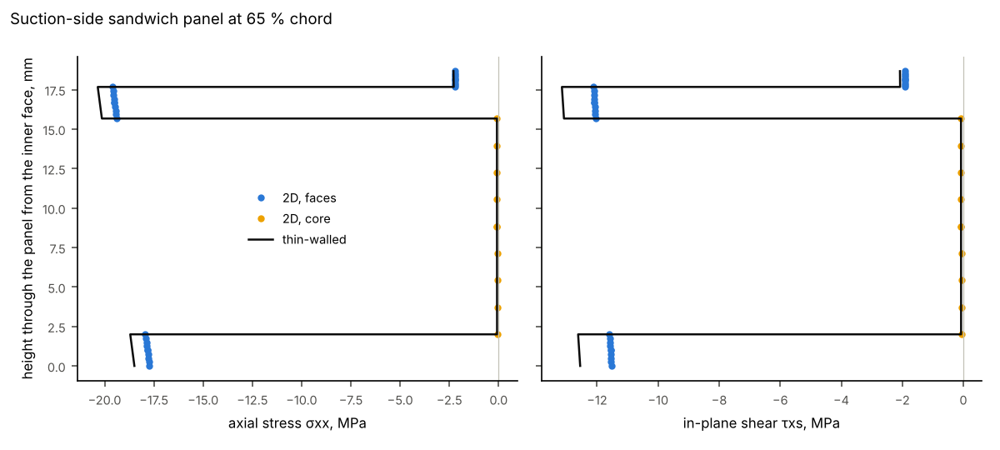

# 2D section stresses of an IEA 15 MW blade section

The 70 % span section of the IEA Wind 15 MW blade (r = 84.7 m, chord 3.27 m) is cut by
implicit-geometry-kernel and meshed with layered `Q8` elements, two rows per ply. It
carries the section forces 20 m inboard of a 200 kN flapwise tip force, together with a
100 kN·m torque. The example compares the 2D stresses with the thin-walled model's ply
stresses, and shows two things only the 2D section can give: interlaminar stresses where
a web meets a spar cap, and the through-thickness state of a sandwich panel.

```
python examples/blade_section_2d/run.py
```

It needs implicit-geometry-kernel (`pip install -e .[geometry]`) and takes about 30 s.
The figures and `summary.json` are written here.

## Model

| | |
|---|---|
| Section | `examples/iea15mw/stations.py`, station 20: layout 2D-F, two webs at 18.6 % and 40.9 % chord |
| Skin | gelcoat 1 mm, glass triax 2 mm, foam 13.7 mm, glass triax 2 mm (18.7 mm) |
| Spar caps | carbon UD 70 mm, inside the skin between the webs |
| Webs | glass biax 1 mm, foam 20 mm, glass biax 1 mm |
| Mesh | `section_mesh_from_cut(cut, laminates, rows_per_ply=2)`: 2196 `Q8` elements |
| Section forces | `[N, M_y, M_z, V_y, V_z, T] = [0, -4 MN·m, 0, 0, 200 kN, 100 kN·m]` |

## Results



The carbon caps carry the bending. The mean axial stress over the suction-side cap is
−115.4 MPa in the 2D section and −121.8 MPa in the thin-walled model, 5.2 % less. Most of
that difference is in the geometry: the 2D mesh follows the true wall outlines, so its
caps run out to the outer faces of the webs and hold 6.5 % more carbon than the
thin-walled caps, which end at the web mid-lines. The 2D section is 5.3 % stiffer in flap
bending for that reason (see `post_processing/validation_visualisers/iea15mw_sections`).



`SolidSectionAnalysis.interface_stresses` recovers σnn, τsn and τxn on all 834 ply
interfaces from the two element rows of each ply next to the interface. The largest
interlaminar shear, 2.4 MPa (τxn) with σnn = 1.2 MPa, is on the skin-to-cap interface
of the pressure-side cap where the rear web meets it. A thin-walled section cannot
resolve it: its walls meet at a point on their mid-lines.



Through the suction-side panel at 65 % chord, the faces carry the axial stress and the
in-plane shear of the torque, and the foam core carries almost none. The 2D face
stresses are about 5 % below the thin-walled ones, as in the caps. Transverse shear in this aft
panel is negligible (tens of Pa) because the flapwise shear goes through the webs.
