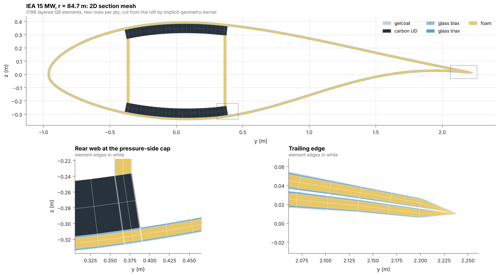
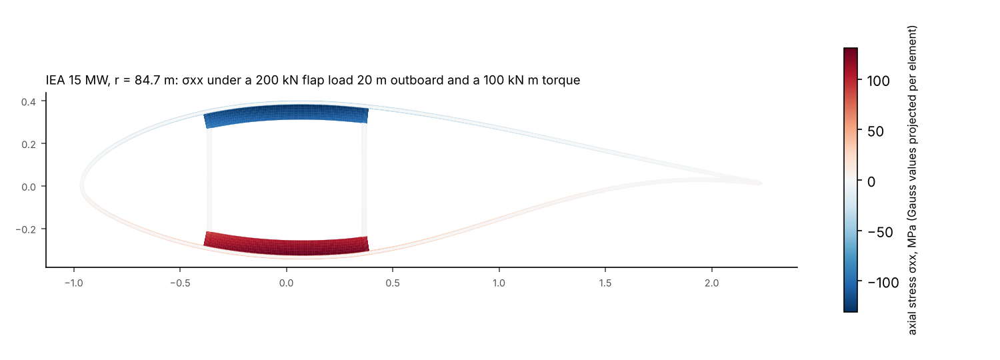
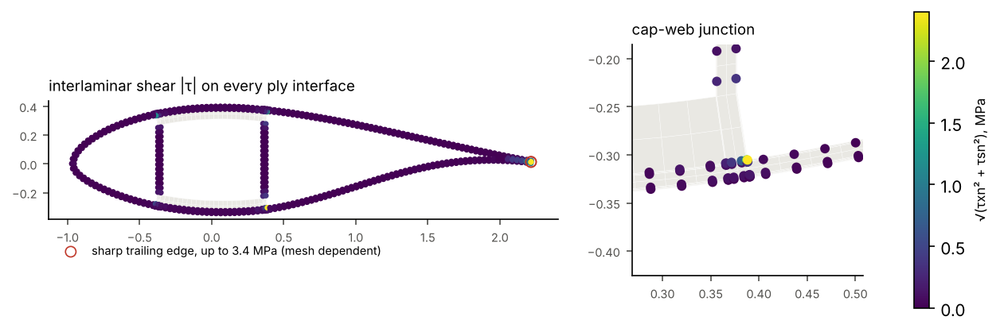
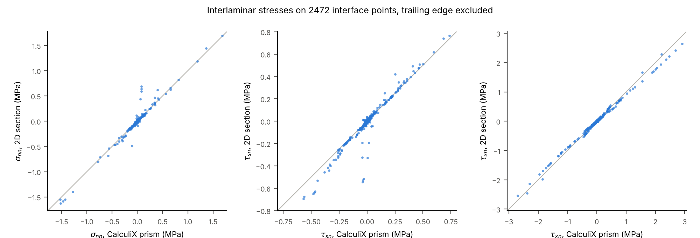
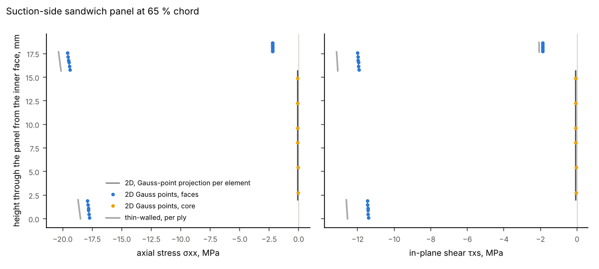

# 2D section stresses of an IEA 15 MW blade section

The 70 % span section of the IEA Wind 15 MW blade (r = 84.7 m, chord 3.27 m) is cut by
implicit-geometry-kernel and meshed with layered `Q8` elements, two rows per ply. It
carries the section forces 20 m inboard of a 200 kN flapwise tip force, together with a
100 kN·m torque. The example compares the 2D stresses with the thin-walled model's ply
stresses, and shows two things only the 2D section can give: interlaminar stresses where
a web meets a spar cap, and the through-thickness state of a sandwich panel.

```
python examples/blade_section_2d/run.py
```

It needs implicit-geometry-kernel (`pip install -r requirements-geometry.txt`, Python 3.11 or later) and takes about 30 s.
The figures and `summary.json` are written here. The comparison with the 3D solid reads the
committed prism reference, so it does not need CalculiX.

## Model

| | |
|---|---|
| Section | `examples/iea15mw/stations.py`, station 20: layout 2D-F, two webs |
| Skin | gelcoat, glass triax, foam core, glass triax (the station's sandwich panel layup) |
| Spar caps | carbon UD, inside the skin between the webs |
| Webs | glass biax, foam core, glass biax |
| Mesh | `section_mesh_from_cut(cut, laminates, rows_per_ply=2)`: 2196 `Q8` elements |
| Section forces | `[N, M_y, M_z, V_y, V_z, T] = [0, -4 MN·m, 0, 0, 200 kN, 100 kN·m]` |



The mesh coloured by material, with close-ups of the rear web at the pressure-side cap and
of the sharp trailing edge (element edges in white).

## Results



The carbon caps carry the bending. The mean axial stress over the suction-side cap is
−115.4 MPa in the 2D section and −121.8 MPa in the thin-walled model, 5.2 % less. Most of
that difference is in the geometry: the 2D mesh follows the true wall outlines, so its
caps run out to the outer faces of the webs and hold 6.5 % more carbon than the
thin-walled caps, which end at the web mid-lines. The 2D section is 5.3 % stiffer in flap
bending for that reason (see `validation/iea15mw_sections`).



`SolidSectionAnalysis.interface_stresses` recovers σnn, τsn and τxn on all 834 ply
interfaces from the two element rows of each ply next to the interface. The largest
interlaminar shear, 2.4 MPa (τxn) with σnn = 1.2 MPa, is on the skin-to-cap interface
of the pressure-side cap where the rear web meets it. A thin-walled section cannot
resolve it: its walls meet at a point on their mid-lines.

### Against a 3D solid



The same mesh extruded into a CalculiX prism of fully integrated `C3D20` bricks, two chords
long and loaded so that a slice at mid-length carries the same section forces
(`validation/iea15mw_sections/make_interlaminar_reference.py`,
committed as `reference/prism_20_interlaminar.json`), gives the interface stresses at the
same Gauss points. Both are taken to the interfaces by the same fit (`prism_check.py`), at
the three Gauss stations along each interface, on 2472 points away from the trailing edge:

- The largest interlaminar shear is at the same place in both, the pressure-side
  skin-to-cap interface by the rear web: 2.75 MPa in the 2D section and 3.00 MPa in the
  prism, so the 2D section is 8 % low there. Along that cap's interface the 2D values are
  8 to 12 % below the prism's.
- Over all points the RMS difference is 0.8 % of the largest value for τxn, 1.5 % for σnn
  and 3.1 % for τsn. The few points off the line in σnn and τsn are at the ends of the
  caps, where 1 mm elements meet the cap's corner.
- The prism converges along the span: 16 bricks along it instead of 12 change the
  interface shear by 0.02 %. A prism one chord long is too short: its ends reach the
  mid-length slice.
- Reduced-integration `C3D20R` bricks (used for the stiffness prisms) do not give these
  stresses: the interlaminar shear alternates in sign from one thin ply element to the
  next, since the bricks are up to 500 times longer than a ply row is thick.

The sharp trailing edge is drawn apart (open red rings). There the skin plies close on
each other at a zero-radius corner, so the interface stresses of the last elements grow
with refinement (3.4 MPa on this mesh). They are a property of the idealised geometry,
not a result; the largest value is taken more than 2 % of the chord from the tip.



Through the suction-side panel at 65 % chord, the faces carry the axial stress and the
in-plane shear of the torque, and the foam core carries almost none. The 2D face
stresses are about 5 % below the thin-walled ones, as in the caps. Transverse shear in this aft
panel is negligible (tens of Pa) because the flapwise shear goes through the webs.
