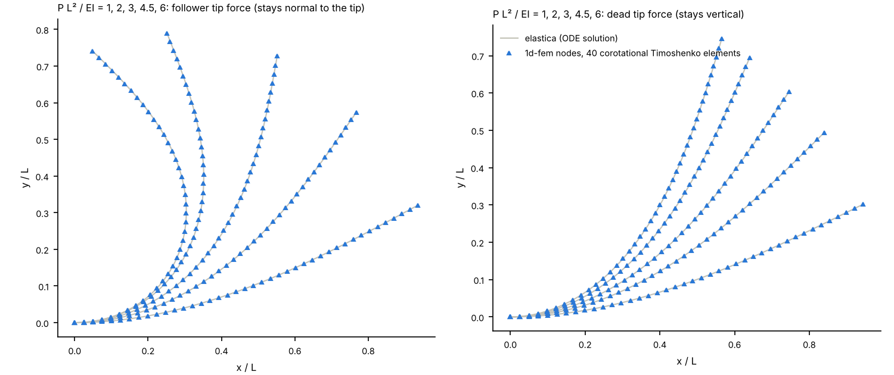

# Follower loads

A follower load is a nodal force or moment that turns with the node it acts on. It goes in
`follower_load.txt` (see `docs/conventions/JOB_INPUT_FOLLOWER_LOADS.md`):

```
[Follower load]
# x  y  z   F_x F_y F_z   M_x M_y M_z
1.0  0  0   0   250 0     0   0   0
```

Nonlinear static jobs turn the load with the node's rotation, `R F_0` and `J^T R M_0`, and
add its unsymmetric load stiffness to the Newton tangent at every iteration
(`processing/static/follower_loads.py`).

```
python examples/follower_loads/run.py
```

A cantilever (40 `CorotationalTimoshenkoBeamElement3D` elements, slender section) carries a
tip force up to P L²/EI = 6. In one set of jobs the force stays normal to the tip. In the
other it stays vertical. The references are the planar elastica with each kind of force,
solved by shooting from the tip with continuation in the load.



The markers are the nodes of the deformed beam. The lines are the elastica.

| P L²/EI | Follower: tip error / L | Follower: tip rotation error (rad) | Dead: tip error / L | Dead: tip rotation error (rad) |
|---|---|---|---|---|
| 1 | 5e-6 | 3e-5 | 4e-6 | 3e-5 |
| 2 | 1.3e-4 | 2.1e-4 | 6e-5 | 1.0e-4 |
| 3 | 3.8e-4 | 5.9e-4 | 1.2e-4 | 1.7e-4 |
| 4.5 | 8.0e-4 | 1.3e-3 | 1.9e-4 | 2.2e-4 |
| 6 | 1.0e-3 | 1.9e-3 | 2.4e-4 | 2.4e-4 |

The error is discretisation: it falls about 16 times (h⁴) from 20 to 40 elements. The follower beam bends further for the same
load, curling back past the vertical, so it needs more elements for the same accuracy.

`tests/test_follower_loads.py` checks the tangent operator, the load stiffness against
finite differences, the parser, both cantilevers against the elastica, and that a linear
job refuses `follower_load.txt`.

Nodal moments in `point_load.txt` are still added to the rotation-vector DOFs as given,
without the `J^T` factor, so at large rotations they are not exactly fixed spatial moments.
This work does not change them.
