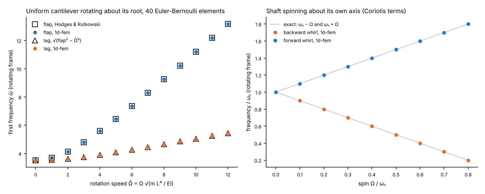

# Rotating beams

1d-fem analyses a structure spinning at a constant rate in the rotating frame. A
`[Rotation]` block in `simulation_settings.txt` turns it on (see
`docs/conventions/SIMULATION_SETTINGS_TAXONOMY.md`):

```
[Rotation]
rpm = 7.55
axis = 0, 1, 0
origin = -3.0, 0, 0
omega_sweep = 0, 0.4, 0.8      # optional: a Campbell table, rad/s
```

Every element forms its rotating-frame terms in its own Gauss loop
(`pre_processing/element_library/rotating_frame.py`). Four point masses per Gauss station
carry the section's mass, mass centre and second moments, and move with the element's own
field interpolation. The terms are:

- the centrifugal load;
- spin softening;
- the rotation-load stiffness of a section turning out of the plane of rotation (the propeller moment);
- the Coriolis (gyroscopic) matrix.

Eigen jobs add the stiffening of the centrifugal state, `K_sigma`. The Gauss data are
written to `rotating_frame_gauss.csv`.

```
python examples/rotating_beam/run.py
```



| Check | 1d-fem against the exact value |
|---|---|
| Flap frequency of a uniform cantilever rotating about its root, Ω̄ = 0 to 12 (Hodges & Rutkowski 1981) | within 0.014 % |
| Lag frequency, ω_lag² = ω_flap² − Ω² | within 0.02 % |
| Whirl of a shaft spinning about its own axis, ω₁ ∓ Ω | within 0.03 % of ω₁ |

Both cases use 40 Euler-Bernoulli elements. Hodges' beam is inextensible. Here the
centrifugal stretch adds Ω̄² I / (A L²) to the tension, so the section is slender enough to
make that negligible. A stubby section stiffens a little more, which is real.

The computed frequencies are markers at the speeds solved, and so are the reference
values. Only the exact whirl relation is drawn as lines.

`tests/test_rotating_frame.py` covers the same checks, and also:

- the propeller moment: ω² = ω₀² + Ω² (I_z − I_y)/(I_y + I_z), exact;
- the centrifugal stretch of a bar in a static job, against the closed-form solution with spin softening;
- the point masses, which reproduce the section mass properties.
