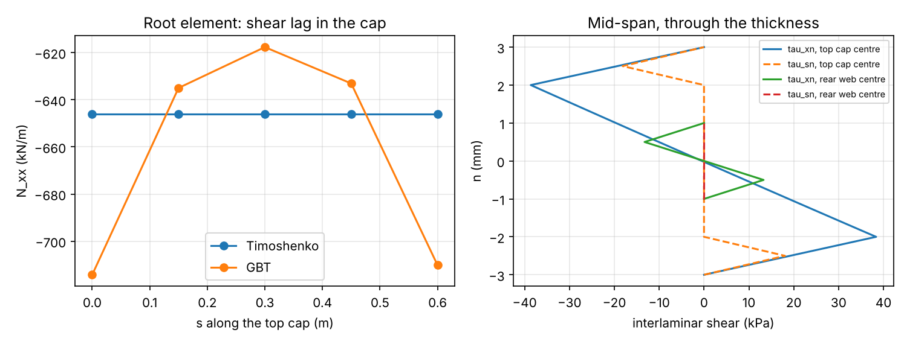
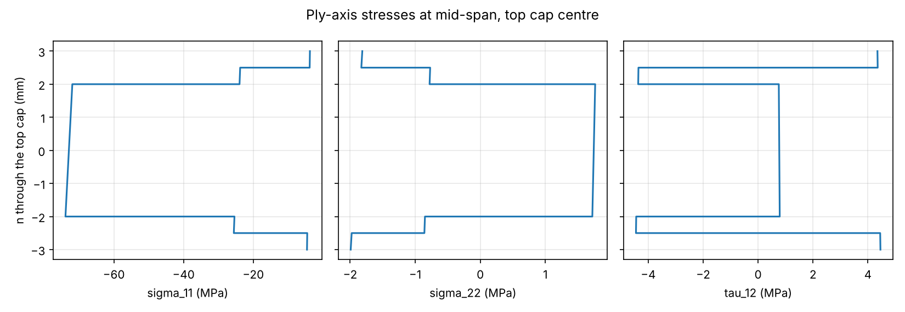
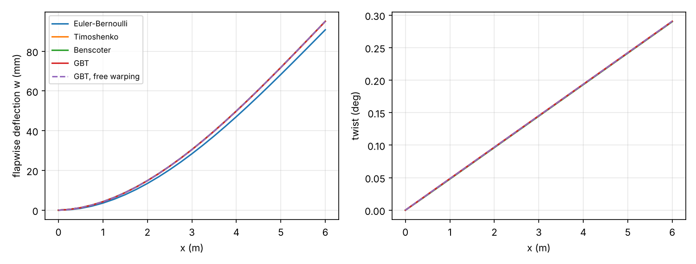

# Example 1: composite box spar

A 6 m CFRP box spar cantilever under a 20 kN flapwise tip force and a 5 kN·m
tip torque, solved with four beam theories, then taken down to ply and
interlaminar stresses.

```
python examples/thin_walled/box_spar/run.py
```

The script writes the job inputs to `jobs/` and the 1d-fem results to
`results/` (neither is tracked), then `summary.json` and the figures here.

## Model

| | |
|---|---|
| Section | box 0.6 m wide (y) × 0.3 m high (z), four walls, `n_sub = 4` |
| Caps (top, bottom) | `[45, -45, 0×8, -45, 45]`, 0.5 mm plies, 6 mm |
| Webs | `[45, -45, -45, 45]`, 0.5 mm plies, 2 mm |
| Ply | E1 = 135 GPa, E2 = 10 GPa, G12 = 5 GPa, ν12 = 0.3 |
| Beam | L = 6 m, 24 elements, clamped root with all warping DOFs fixed |

Cases: Euler-Bernoulli, Timoshenko, Benscoter (`[warping] = 1`), GBT with
2 distortional modes and 6 shear-lag modes, and the same GBT with the root
warping amplitudes left free.

## Results

| Case | Tip w (mm) | Tip twist (mrad) |
|---|---|---|
| Saint-Venant beam, exact (unit-load integral of the 6×6 flexibility) | 95.12 | 5.071 |
| Euler-Bernoulli | 90.81 | 5.071 |
| Timoshenko | 95.08 | 5.071 |
| Benscoter | 95.08 | 5.059 |
| GBT | 95.04 | 5.069 |
| GBT, free root warping | 95.08 | 5.071 |

- Timoshenko is 0.04 % below the exact tip deflection with 24 linear elements
  and 0.01 % with 48 (mesh convergence). Euler-Bernoulli misses the 4.5 %
  shear deflection.
- Restraining the root warping stiffens torsion by 0.2 % (Benscoter) and
  flapwise bending by 0.05 % (GBT, shear lag). With the warping free, GBT
  returns the Saint-Venant beam.
- Torque shear flow in the walls: 13 883 N/m from 1d-fem against
  13 889 N/m from Bredt-Batho, `q = T / 2A` (0.04 %; the 1d-fem walls also
  twist as plates).
- `wall_stresses.csv` from `process_job` matches the direct recovery
  (`csv_vs_direct_N_xx`).

### Shear lag at the root



Left: `N_xx` across the top cap in the root element. Timoshenko keeps the
section plane, so `N_xx` is uniform. GBT with the root warping fixed shows
shear lag: the cap is 10.5 % more loaded at the corners and 4.4 % less at the
centre than the beam value. Right: interlaminar shear through the top cap and
rear web at mid-span. At the cap centre `tau_xn` comes from the 0° plies taking
more of the bending gradient than the ±45° plies; it is zero at both faces.

### Ply stresses



Ply-axis stresses through the top cap at mid-span (compression side). The
0° plies carry −74 MPa fibre stress; the ±45° plies carry the torque shear.

### Deflection and twist



## What is not checked here

The plan's acceptance check, a shell model within 3 %, needs a shell solver
and is not in this repository. The checks here are against the exact
Saint-Venant beam and Bredt-Batho.
