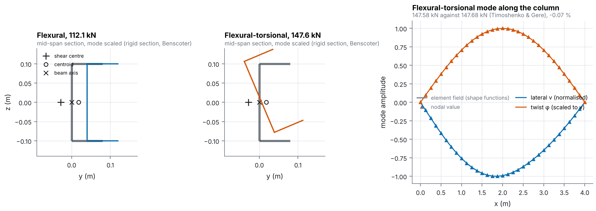
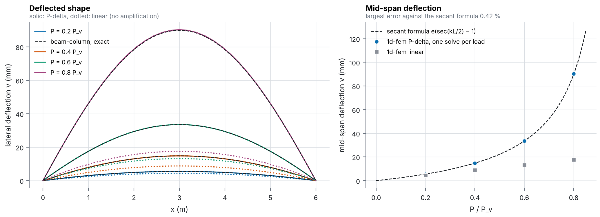

# Channel column: flexural-torsional buckling and P-delta

A steel channel (web 200 mm, flanges 80 mm, walls 4 mm) on fork supports. The beam axis is
the web, so both the shear centre (28 mm behind the web) and the centroid (18 mm in front)
are off the axis.

```
python examples/thin_walled/channel_buckling/run.py
```

1. **Linear buckling** with Benscoter elements (4 m, compression at the centroid). The
   flexural-torsional load is 147 585 N against 147 682 N from the Timoshenko & Gere cubic
   (−0.07 %). The pure flexural mode along the symmetry axis comes first, at 112 067 N.
2. **P-delta** with Timoshenko elements (6 m, compression at the web, eccentric to the
   tension centre). The midspan deflection follows the secant formula
   `e (sec(kL/2) − 1)` to 0.4 % up to 0.8 `P_v`; the linear solution misses the
   amplification (`p_delta.png`).



Left and middle: the section at mid-span (grey, at true wall thickness) and the
same section moved by the computed mode (rigid section, as Benscoter keeps it).
The flexural mode translates the section along the symmetry axis; the
flexural-torsional mode translates and twists it about the beam axis on the
web. Right: lateral deflection and twist of the flexural-torsional mode along
the column, each element through its own interpolation, nodes as triangles.



Left: the deflected shape at each load, P-delta (solid) and linear (dotted),
against the exact beam-column shape `e (cos(k(x − L/2)) / cos(kL/2) − 1)`.
Right: mid-span deflection, one marker per solve, against the secant formula.

Results are in `summary.json`. Method: [docs/element_library/second_order.md](../../../docs/element_library/second_order.md).
