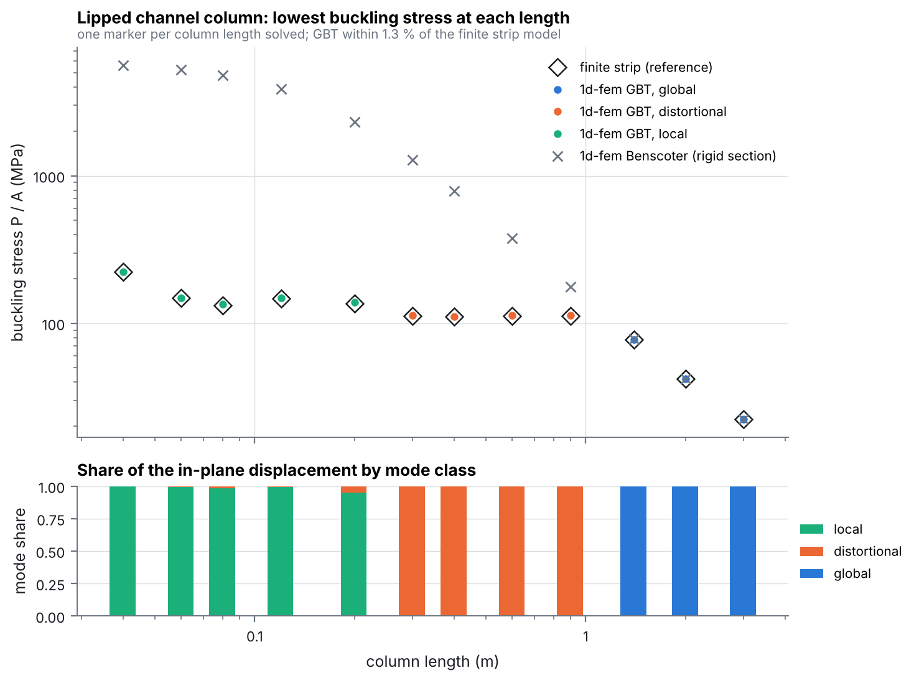
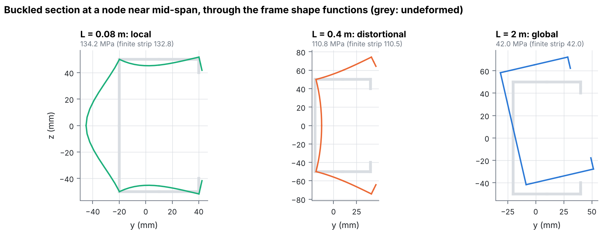

# Local, distortional and global buckling of a lipped channel column

An aluminium lipped channel (centre lines: web 100 mm, flanges 60 mm, lips 10 mm; walls
2 mm) is compressed at its centroid. Both ends are simply supported: `UY UZ RX` held, a
diaphragm (`a_k = 0`), and warping free. 1d-fem's linear buckling with
`LinearGBTBeamElement3D` is run for twelve lengths from 40 mm to 3 m.

```
python examples/thin_walled/gbt_buckling/run.py
```

It takes about 4 minutes.

- The section has `n_sub = 2`, and the element carries its first 10 modes. Two are
  distortional and eight are local plate modes.
- The elements are about 10 mm long (16 to 120 per column).
- The reference is a finite strip model of the same column (`finite_strip.py`). It uses
  full plate theory, with none of GBT's hypotheses, and takes the lowest buckling stress
  over the number of half-waves.
- Benscoter elements, which keep the section's shape, give the global buckling alone.



Top: one marker per column length solved. Bottom: the share of the buckling
mode's in-plane displacement that is local, distortional or global.

| Length | GBT | Finite strip | GBT / strip | Mode |
|---|---|---|---|---|
| 0.04 m | 224.3 MPa | 223.4 MPa | 1.004 | local |
| 0.08 m | 134.2 MPa | 132.8 MPa | 1.011 | local |
| 0.20 m | 138.4 MPa | 136.6 MPa | 1.013 | local, 2 half-waves |
| 0.40 m | 110.8 MPa | 110.5 MPa | 1.003 | distortional |
| 0.90 m | 112.7 MPa | 111.9 MPa | 1.007 | distortional, 3 half-waves |
| 1.40 m | 77.6 MPa | 77.7 MPa | 1.000 | flexural-torsional |
| 3.00 m | 22.3 MPa | 22.4 MPa | 0.999 | flexural-torsional |

All twelve lengths are in `summary.json`.

- **One model covers all three kinds of buckling.** Short columns buckle locally, at a
  half-wavelength of about 80 mm. Columns from 0.3 to 0.9 m buckle distortionally: the
  flange and lip rotate about the web junction, at a half-wavelength of about 0.3 m. Longer
  columns buckle globally in flexure and torsion.
- **Accuracy.** GBT is within 1.3 % of the finite strip model at every length. In local and
  distortional buckling it is 0.3 to 1.3 % stiff, because its modes are inextensible and
  have no membrane shear across the section (the Vlasov hypotheses). In global buckling it
  is within 0.1 %.
- **Without the modes.** The rigid-section Benscoter beam agrees in the global range only.
  At 0.4 m it gives 7 times the distortional load, and at 80 mm 36 times the local load.
- **Mode classes.** The buckling mode is labelled local, distortional or global by its
  largest share of the section's in-plane displacement, summed over the nodes. A section
  mode counts as local when the folds, where walls meet, stay within 5 % of its peak
  displacement. Every computed mode is close to pure: its largest share is at least 0.94.



The buckled sections are drawn at a node near midspan from the nodal mode amplitudes. The
section modes and the frame's own shape functions (linear tangential, cubic Hermite normal
displacement) give the field along every wall, so no curve is fitted.

## Files

| | |
|---|---|
| `run.py` | writes and runs the GBT and Benscoter buckling jobs, the finite strip reference and the plots |
| `finite_strip.py` | semi-analytical finite strip model (simply supported, one half-wave) |
| `summary.json` | buckling stress, finite strip value, mode shares and governing class per length |

Method: [docs/element_library/gbt_buckling.md](../../../docs/element_library/gbt_buckling.md).
