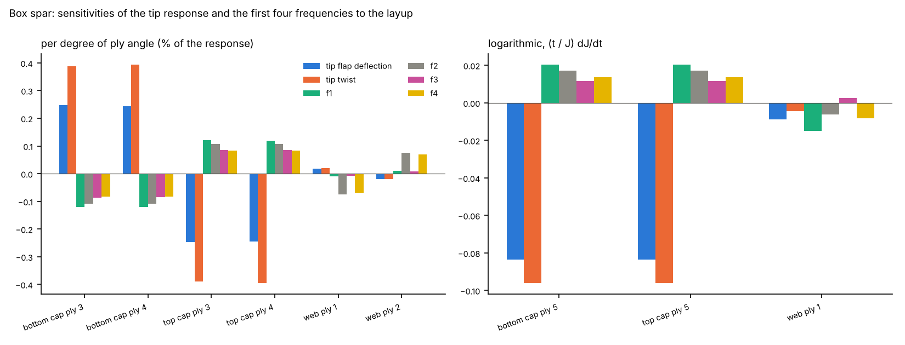
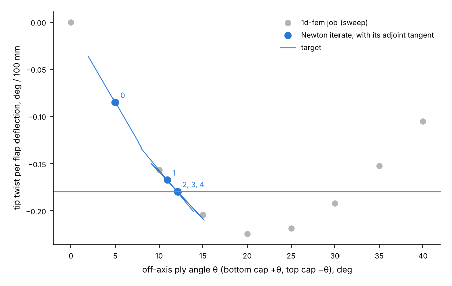

# Sensitivities of a box spar to its layup

```
python examples/thin_walled/layup_sensitivity/run.py
```

About 5 minutes (about 60 jobs, most of them for the finite-difference check).

A 6 m CFRP cantilever box spar, 0.6 x 0.3 m, 12 Timoshenko elements, with a 20 kN flap
force at the tip. Each cap is `[45, -45, θ, θ, 0, 0, 0, 0, -45, 45]` (0.5 mm plies), with
`+θ` on the bottom cap and `-θ` on the top cap in wall axes. That is the same fibre
direction on both caps in the global frame, so the spar twists when it bends (bend-twist
coupling, as in an aeroelastically tailored blade). The webs are `[45, -45, -45, 45]`.
θ = 20° for the sensitivities.

## What it does

1. **Sensitivities.** A static job and an eigen job, each with `layup_sensitivity.txt`,
   write `layup_sensitivity.csv`: the derivatives of the tip flap deflection `UZ@12`, the tip
   twist `RX@12`, the compliance and the first four frequencies with respect to nine
   parameters (the off-axis pair of each cap and the ±45 pair of the webs by angle; one 0°
   ply of each cap and one web ply by thickness). Method:
   [docs/element_library/layup_sensitivity.md](../../../docs/element_library/layup_sensitivity.md).
2. **Check.** Every derivative against central differences of two re-solved jobs
   (h = 10⁻³ degrees, 10⁻⁸ m).
3. **Design.** Newton iterations on θ, with the two caps linked (`θ_top = -θ`), to reach a
   tip twist of −0.18° per 100 mm of flap deflection. The gradient of each step is the sum of
   the job's own angle sensitivities, so each step is one job.

## Results

| Response | Value at θ = 20° |
|---|---|
| tip flap deflection | 138.3 mm |
| tip twist | −0.310° (−5.41 mrad) |
| f1, f2, f3, f4 | 14.87, 18.40, 83.05, 108.99 Hz |

All 63 derivatives agree with central differences to within 1.0 × 10⁻⁵ (relative); the
largest difference is the step error of the differences themselves.



Left: change per degree of ply angle, as a percentage of the response. The off-axis pair
of the bottom and top caps have equal and opposite effects, as they must by symmetry, and
the twist is the most sensitive response. Right: the logarithmic thickness derivatives
`(t / J) dJ/dt`. Thickening one 0° cap ply by 1 % reduces the tip deflection by 0.08 % and
raises f1 by 0.02 %.



At θ = 20° the coupling is close to its largest (about −0.224° per 100 mm), so the
target is set below it. Grey: the ratio from a sweep of jobs at 5° steps. Blue: the Newton
iterates from θ = 5°, each with its tangent from the adjoint gradient. The loop reaches the
target at θ = 12.138° in four jobs.

| Iteration | θ, deg | twist per flap deflection, deg / 100 mm |
|---|---|---|
| 0 | 5.000 | −0.0850 |
| 1 | 10.920 | −0.1671 |
| 2 | 12.070 | −0.1793 |
| 3 | 12.138 | −0.18000 |

## Files

- `run.py`: the model, the check and the design loop.
- `summary.json`: values, derivatives, the check against central differences, the design
  history and the sweep.
- `jobs/` and `results/` are written by the run and not tracked.
