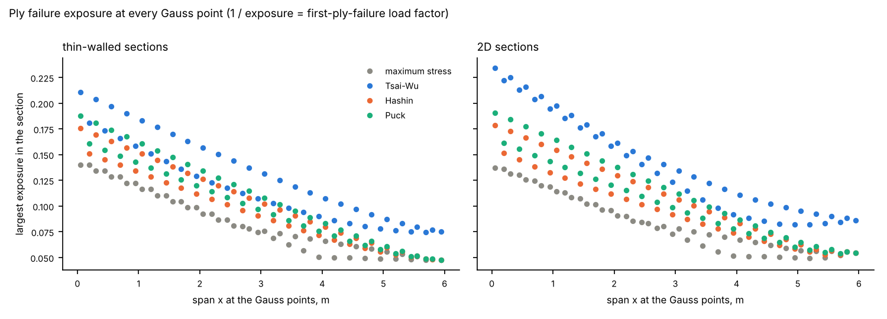
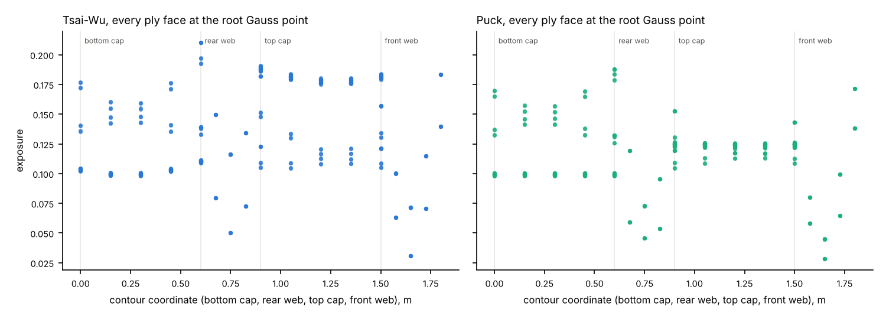

# Ply failure margins at the Gauss points

The CFRP box spar of [box_spar](../box_spar/README.md) (0.6 × 0.3 m, 6 mm caps
`[±45, 0₈, ∓45]`, 2 mm `±45` webs, 6 m) carries a 20 kN flapwise tip force and a
5 kN·m torque. The job has a `ply_strength.txt`, so 1d-fem checks every ply against four
criteria and writes `secondary_results/ply_failure/ply_failure.csv`:

- the criteria are maximum stress, Tsai-Wu, Hashin and Puck;
- every Gauss point of every element is checked (the Gauss points of the stiffness
  integration, cached on the element objects);
- on thin-walled sections, the checks run at the bottom and top of every ply, at points
  along each wall;
- on 2D sections, the checks run at every quadrature point of the section mesh, in
  material axes.

```
python examples/thin_walled/ply_failure/run.py
```

It takes about 2 minutes. The strengths are carbon-epoxy values (T300/914-like): `Xt` 1500,
`Xc` 1200, `Yt` 50, `Yc` 200 and `S12` 70 MPa, with Puck's carbon parameters
`p⊥∥+ = 0.35`, `p⊥∥− = 0.30` and `p⊥⊥ = 0.25`.

Each criterion gives an **exposure** `f` that scales linearly with the load. Its reserve
factor `1 / f` is therefore the first-ply-failure load factor of this linear run, and the
margin is `1 / f − 1`.



| First-ply failure | Thin-walled | 2D sections | Mode, place |
|---|---|---|---|
| Maximum stress | 7.12 × load | 7.28 × load | in-plane shear, rear web |
| Tsai-Wu | 4.75 × load | 4.26 × load | rear web at the cap corner |
| Hashin | 5.69 × load | 5.59 × load | matrix tension, rear web |
| Puck | 5.33 × load | 5.24 × load | inter-fibre mode A, rear web |

- All four criteria put first failure at the root, in the outer `±45` ply of the rear web
  where it meets the bottom cap. There, the flapwise shear and the torque shear flow add up.
- The interactive criteria (Tsai-Wu, Hashin, Puck) fail the matrix at 4.3–5.7 times the
  load. Maximum stress, which ignores the interaction of transverse tension and shear,
  gives 7.1 times.
- The thin-walled and 2D sections agree within 2 % for Hashin, Puck and maximum stress.
  Tsai-Wu differs by 10 % because its worst point is the cap–web corner, where the 2D mesh
  resolves the stress concentration that thin walls cannot.
- Each two-node Timoshenko element has constant curvature, so its two Gauss points carry
  nearly the same bending stresses. The steps along the span are the exact FEA data, not
  noise.



At the root Gauss point, every ply face is plotted around the contour (bottom cap, rear
web, top cap, front web). The webs carry the highest exposures. In the caps, the 0° plies
are only at about 0.1 of their fibre strength.

## Files

| | |
|---|---|
| `run.py` | writes and runs the two jobs, reads `ply_failure.csv`, plots |
| `summary.json` | first-ply failure per criterion and section model |

Method: [docs/element_library/ply_failure.md](../../../docs/element_library/ply_failure.md).
