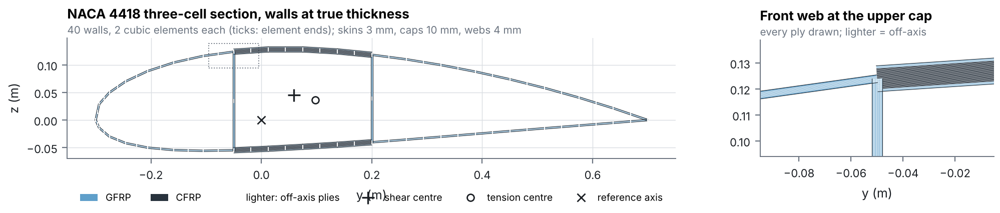
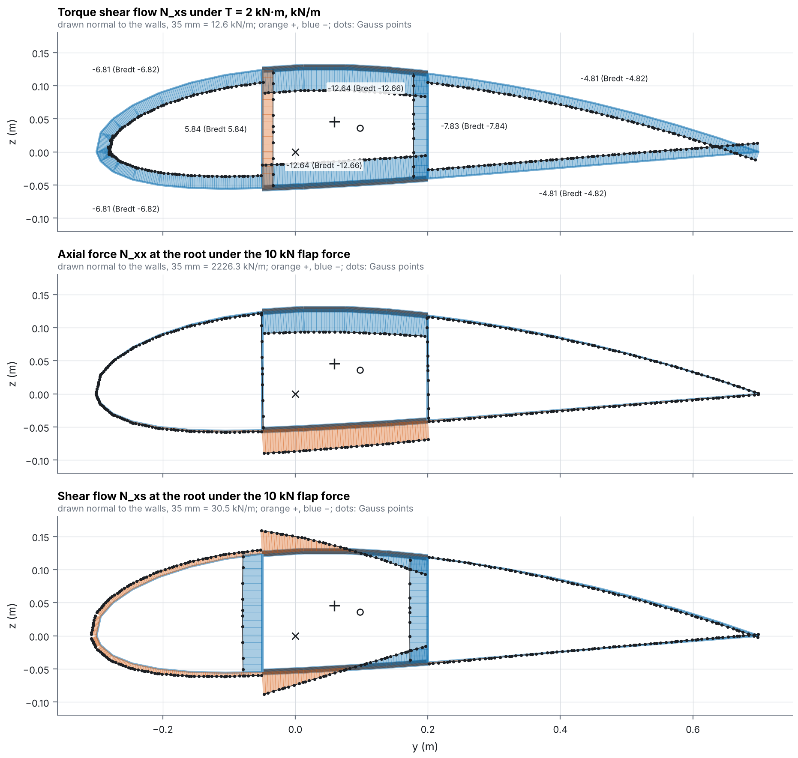
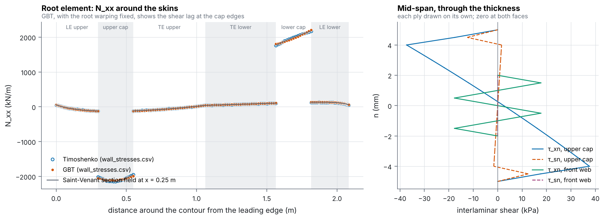
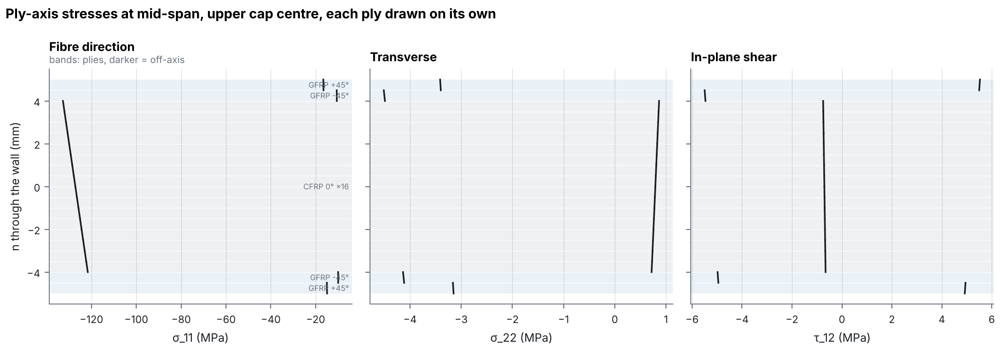
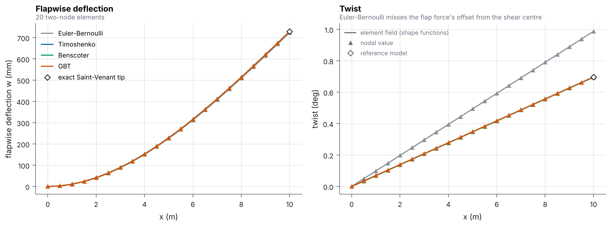

# Example 2: three-cell blade section

A 10 m cantilever with a three-cell NACA 4418 blade section (1 m chord, GFRP
skins and webs, CFRP spar caps) under a 10 kN flapwise tip force and a
2 kN·m tip torque, both applied at the reference axis at 30 % chord.

```
python examples/thin_walled/three_cell_blade/run.py
```

It takes about 2.5 minutes. The script writes the job inputs to `jobs/` and
the 1d-fem results to `results/` (neither is tracked), then `summary.json` and
the figures here.

## Model

| | |
|---|---|
| Outline | NACA 4418 with a closed trailing edge, 15 points per skin (cosine spacing toward the leading edge), points on both skins at the webs; 40 straight walls |
| Webs | at 25 % and 50 % chord |
| Skins | GFRP `[0, 45, -45, -45, 45, 0]`, 0.5 mm plies, 3 mm |
| Spar caps (between the webs, 4 walls per skin) | `[45, -45]` GFRP, 16 × 0° CFRP, `[-45, 45]` GFRP, 10 mm |
| Webs | GFRP `[45, -45, -45, 45] × 2`, 4 mm |
| GFRP ply | E1 = 41 GPa, E2 = 10 GPa, G12 = 4 GPa, ν12 = 0.28 |
| CFRP ply | E1 = 135 GPa, E2 = 10 GPa, G12 = 5 GPa, ν12 = 0.3 |
| Section mesh | 2 cubic elements per wall (`n_sub = 2`) |
| Beam | L = 10 m, 20 elements, clamped root with all warping DOFs fixed |

Cases: Euler-Bernoulli, Timoshenko, Benscoter (`[warping] = 1`) and GBT with
2 distortional modes and 4 shear-lag modes.



Every wall is drawn at its laminate thickness about its mid-line, ply by ply,
coloured by material and lighter for off-axis plies. The ticks on the walls
are the ends of the section's wall elements.

## Results

The shear centre is at y = 0.059 m, z = 0.046 m from the reference axis
(36 % chord), inside the spar box.

| Case | Tip w (mm) | Tip twist (mrad) |
|---|---|---|
| Saint-Venant beam, exact (unit-load integral of the 6×6 flexibility) | 730.15 | 12.164 |
| Euler-Bernoulli | 723.81 | 17.242 |
| Timoshenko | 729.70 | 12.164 |
| Benscoter | 729.70 | 12.137 |
| GBT | 729.66 | 12.167 |

- Euler-Bernoulli carries no shear force, so it misses the twist from the
  flapwise force acting 59 mm ahead of the shear centre (589 N·m against the
  2 kN·m torque) and over-predicts the twist by 42 %. The beams with shear
  pick this up through the bending-torsion coupling of the 6×6 stiffness.
- Timoshenko matches the exact twist and is 0.06 % short on deflection with 20
  linear elements. Root warping restraint stiffens torsion by 0.2 %
  (Benscoter).
- Torque shear flows in all 40 walls agree with the multi-cell Bredt-Batho
  solution to 0.13 %. The spar box carries 12.6 kN/m in the caps, the
  leading-edge cell 6.8 kN/m and the trailing-edge cell 4.8 kN/m.
- `wall_stresses.csv` from `process_job` matches the direct recovery
  (`csv_vs_direct_N_xx`) to round-off of the beam solve (5 × 10⁻⁹).

### Fields around the section



Each field is drawn normal to its wall from the section's own solution,
evaluated through the cubic shape functions inside every wall element; the
dots are the section's Gauss points. Top: torque shear flow, labelled in kN/m
with the Bredt-Batho value. Middle and bottom: `N_xx` and `N_xs` at the root
under the flapwise force. The caps carry the bending and the webs carry most
of the flapwise shear.

### Caps at the root, interlaminar shear at mid-span



Left: `N_xx` around the skins in the root element, from `wall_stresses.csv`
(markers, the points the job writes) and from the Saint-Venant section field
at the same station (line). The caps are narrow and sit between two webs, so
shear lag is small: GBT, with the root warping fixed, raises the cap ends at
the webs by up to 2.2 % and lowers the cap centre by 1.4 %. Right:
interlaminar shear through the upper cap and the front web at mid-span.

### Ply stresses



Ply-axis stresses through the upper cap at mid-span: the CFRP plies carry up
to 133 MPa fibre compression.

### Deflection and twist



## What is not checked here

The plan's acceptance check, a shell model within 3 %, needs a shell solver
and is not in this repository. The checks here are against the exact
Saint-Venant beam and multi-cell Bredt-Batho.
