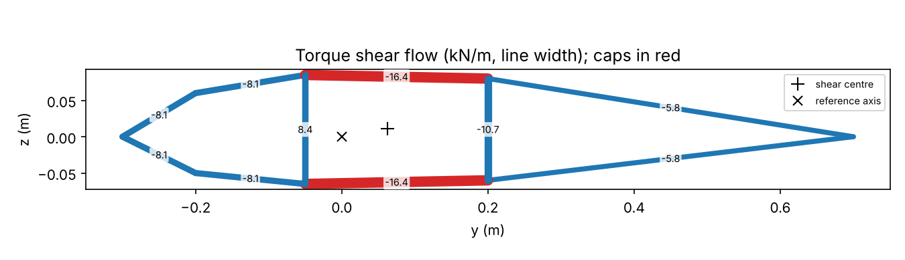
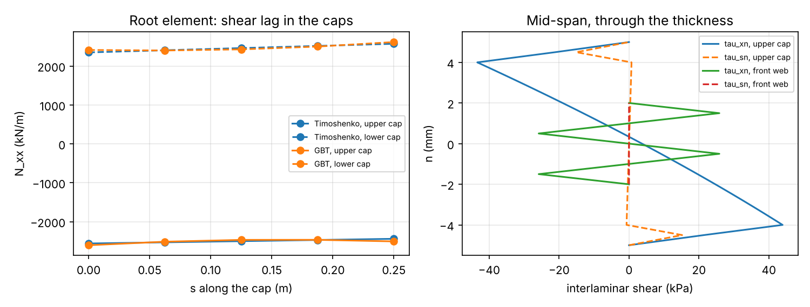
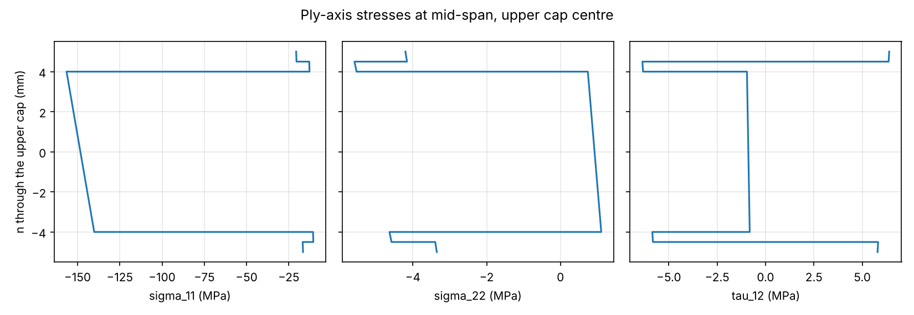
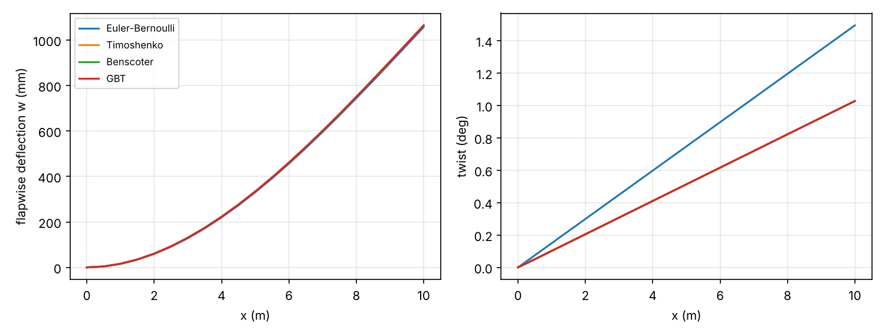

# Example 2: three-cell blade section

A 10 m cantilever with a three-cell, airfoil-like blade section (1 m chord,
GFRP skins and webs, CFRP spar caps) under a 10 kN flapwise tip force and a
2 kN·m tip torque, both applied at the reference axis at 30 % chord.

```
python examples/thin_walled/three_cell_blade/run.py
```

The script writes the job inputs to `jobs/` and the 1d-fem results to
`results/` (neither is tracked), then `summary.json` and the figures here.

## Model

| | |
|---|---|
| Outline | leading edge, three upper and three lower skin points, trailing edge; webs at 25 % and 50 % chord |
| Skins | GFRP `[0, 45, -45, -45, 45, 0]`, 0.5 mm plies, 3 mm |
| Spar caps (between the webs) | `[45, -45]` GFRP, 16 × 0° CFRP, `[-45, 45]` GFRP, 10 mm |
| Webs | GFRP `[45, -45, -45, 45] × 2`, 4 mm |
| GFRP ply | E1 = 41 GPa, E2 = 10 GPa, G12 = 4 GPa, ν12 = 0.28 |
| CFRP ply | E1 = 135 GPa, E2 = 10 GPa, G12 = 5 GPa, ν12 = 0.3 |
| Beam | L = 10 m, 20 elements, clamped root with all warping DOFs fixed |

Cases: Euler-Bernoulli, Timoshenko, Benscoter (`[warping] = 1`) and GBT with
2 distortional modes and 4 shear-lag modes.

## Results



The shear centre is at y = 0.062 m, z = 0.011 m from the reference axis, 36 %
chord, inside the spar box.

| Case | Tip w (mm) | Tip twist (mrad) |
|---|---|---|
| Saint-Venant beam, exact (unit-load integral of the 6×6 flexibility) | 1065.3 | 17.95 |
| Euler-Bernoulli | 1057.1 | 26.09 |
| Timoshenko | 1064.6 | 17.95 |
| Benscoter | 1064.6 | 17.93 |
| GBT | 1064.6 | 17.94 |

- Euler-Bernoulli carries no shear force, so it misses the twist from the
  flapwise force acting 62 mm ahead of the shear centre (624 N·m against the
  2 kN·m torque) and over-predicts the twist by 45 %. The beams with shear
  pick this up through the bending-torsion coupling of the 6×6 stiffness.
- Timoshenko matches the exact twist and is 0.06 % short on deflection with 20
  linear elements. Root warping restraint stiffens torsion by 0.13 %
  (Benscoter).
- Torque shear flows in all ten walls agree with the multi-cell Bredt-Batho
  solution to 0.2 % (figure above, labels in kN/m). The spar box carries
  16.4 kN/m, the leading-edge cell 8.1 kN/m and the trailing-edge cell
  5.8 kN/m.
- `wall_stresses.csv` from `process_job` matches the direct recovery
  (`csv_vs_direct_N_xx`).

### Caps at the root, interlaminar shear at mid-span



Left: `N_xx` along both caps in the root element. The caps are narrow and sit
between two webs, so shear lag is small here: GBT raises the cap edges by up
to 2 % over the plane-section value. Right: interlaminar shear through the
upper cap and the front web at mid-span.

### Ply stresses



Ply-axis stresses through the upper cap at mid-span: the CFRP plies carry
up to 157 MPa fibre compression.

### Deflection and twist



## What is not checked here

The plan's acceptance check, a shell model within 3 %, needs a shell solver
and is not in this repository. The checks here are against the exact
Saint-Venant beam and multi-cell Bredt-Batho.
