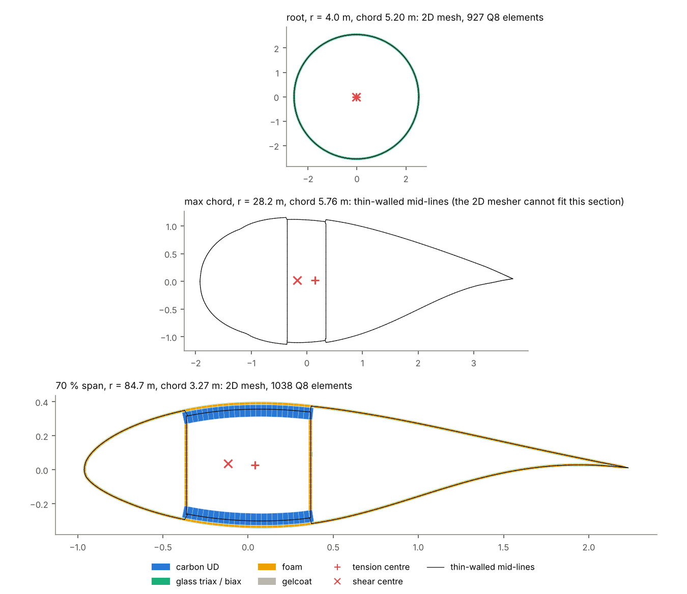
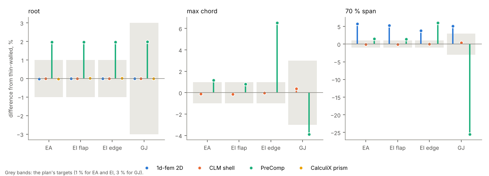

# IEA 15 MW blade-section validation

Validates 1d-fem's two section models on three stations of the IEA Wind 15 MW reference blade: the root (r = 4.0 m), maximum chord (r = 28.2 m) and 70 % span (r = 84.7 m). The models are the thin-walled section (`thin_walled_from_cut`, `hoop="free"`) and the 2D layered `Q8` section (`section_mesh_from_cut`). Each station is checked against three independent models:

- a composite-laminate-model (CLM) shell segment;
- PreComp;
- a CalculiX `C3D20R` prism.

```
python post_processing/validation_visualisers/iea15mw_sections/run.py
```

`run.py` needs implicit-geometry-kernel and takes about a minute. It computes the 1d-fem sections and reads the other models from `reference/`, then writes `summary.json`, `report.md`, `sections.png` and `stiffness_differences.png`.

## Same geometry for every model

implicit-geometry-kernel (IGK) cuts each station with one idealised layup (`examples/iea15mw/stations.py`):

- the sandwich skin all round;
- the carbon of the spar caps inside the skin between the webs;
- the two foam-cored webs.

There is no trailing-edge reinforcement. The layups come from the PreComp inputs of the published blade, copied from composite-laminate-model example 24.

Every model, PreComp included, uses this geometry and these layups. The comparisons therefore test the mechanics, not how each model describes the blade.

| Reference | How it is made | Saved in |
|---|---|---|
| CLM shell | IGK loft 8 chords long, curved Quad8 FSDT shells on the wall mid-surfaces, `beam_section_properties` over the middle fifth (`make_shell_reference.py`) | `reference/shell_*.json` |
| PreComp | WISDEM's PreComp on the same idealised sectors and webs (`make_precomp_reference.py`) | `reference/precomp_idealised.json` |
| CalculiX prism | the 2D mesh extruded 2 chords into `C3D20R` bricks, with a rigid tip. The 6×6 is fitted from the strain energies of 21 load cases over the middle 35 % (`prism.py`, `make_prism_reference.py`, about an hour per station) | `reference/prism_*.json` |

The references are committed because 1d-fem depends on none of their tools.

## Results





Differences are relative to the thin-walled section. Bending is about the tension centre, with the shear forces free.

| Station | Model | EA | EI flap | EI edge | GJ | Centres |
|---|---|---|---|---|---|---|
| root | 2D | −0.02 % | +0.01 % | +0.01 % | +0.01 % | < 0.01 % chord |
| root | shell | 0.00 % | 0.00 % | 0.00 % | 0.00 % | < 0.01 % chord |
| root | prism (vs 2D) | 0.00 % | 0.00 % | 0.00 % | 0.00 % | all 6×6 terms within 0.01 % |
| root | PreComp | +1.97 % | +1.96 % | +1.96 % | +1.98 % | TC < 0.01 % chord |
| max chord | shell | −0.12 % | −0.14 % | −0.02 % | +0.38 % | SC 0.11 % chord |
| max chord | PreComp | +1.16 % | +0.80 % | +6.52 % | −3.88 % | TC 0.15 % chord |
| 70 % span | 2D | +5.79 % | +5.28 % | +3.82 % | +5.07 % | 0.2 % chord |
| 70 % span | shell | −0.02 % | −0.02 % | −0.01 % | +0.43 % | SC 0.07 % chord |
| 70 % span | PreComp | +1.50 % | +1.40 % | +6.00 % | −25.5 % | TC 0.07 % chord |

`report.md` has the full tables, and the 70 % span prism once its reference is in.

### Findings

- **Thin-walled against shell: passes everywhere.** EA and EI agree within 0.14 %, GJ within 0.43 %, and the shear and tension centres within 0.11 % of the chord. Both models put the walls on the same mid-lines.
- **2D against thin-walled: passes at the root, fails at 70 % span, for a geometric reason.** The 2D mesh follows the true outlines, so its spar caps run out to the outer faces of the webs. That gives them 6.5 % more carbon than the thin-walled caps, which end at the web mid-lines.
  - With the 2D cap stiffness scaled to the same carbon, EA is −0.2 %, flap EI −0.9 % and edge EI +1.3 %.
  - GJ is still 4.6 % high. That is the corner and thickness effect of 70 mm caps on 0.7 m wide cells (t/b ≈ 0.1). The plan expected effects of this order where walls are not thin.
- **2D against the CalculiX prism: equal at the root.** All 6×6 terms agree within 0.01 % of their diagonal scale, so the 2D Saint-Venant solution is the 3D solution of the prism. The 70 % span prism is a longer run and its reference is added separately.
- **PreComp:** EA and flap EI are 1–2 % high. PreComp measures wall areas along the outer mould line, which overstates them by about t/(2R): 2 % for the root tube. Edge EI is 6 % high outboard, which is not explained here. GJ is 25 % low at 70 % span, the known PreComp shortfall for multi-cell sections.
- **Max chord has no 2D section.** The layered mesher inverts an element at the blunt trailing edge when the 56 mm sandwich skin closes on itself. The thin-walled, shell and PreComp models are compared there.
