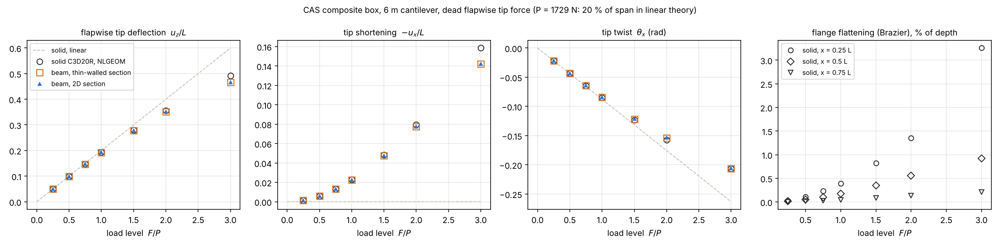
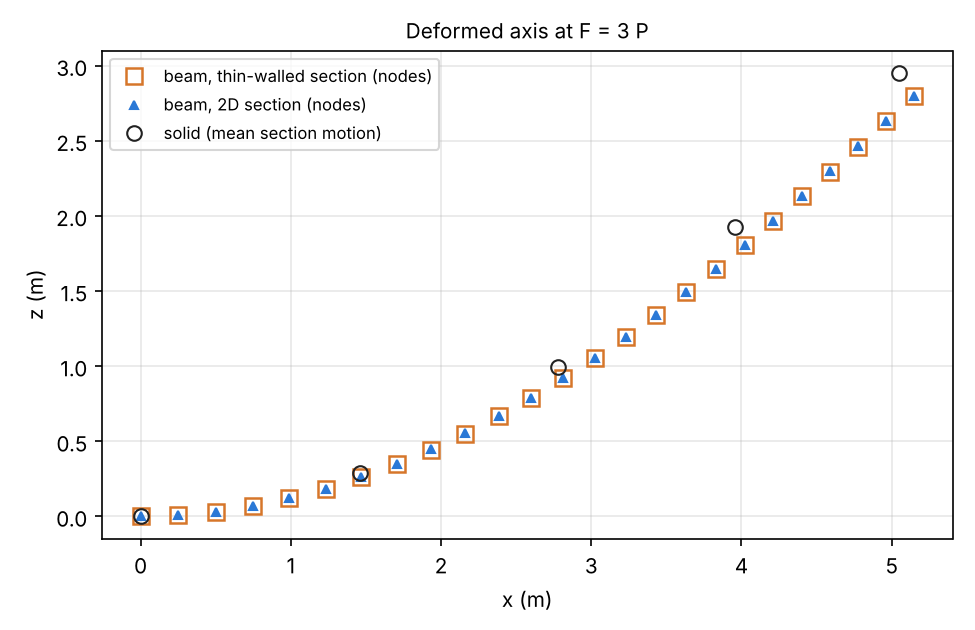

# Corotational beam against a CalculiX NLGEOM solid

The CAS composite box of the shell validation (`abaqus/shell_validation/cases.py`,
`composite_box`) is a 0.1 m square CFRP box with eight 0.5 mm plies per wall, 6 m long. Its
caps are circumferentially asymmetric (+20° and −20° plies), so flapwise bending twists it.
It is clamped at the root and carries a dead flapwise tip force up to 3 P. P deflects the
tip 20 % of the span in linear theory.

- **Solid** (`make_reference.py`): the section is meshed in 2D, one `Q8` row per ply, with
  mitred corners (`SectionMesh.from_thin_walled(..., junctions="mitre")`). It is extruded into
  60 layers of `C3D20R` bricks (57 k nodes), with the tip face tied to a reference node. One
  `NLGEOM` step goes to 3 P, and a second deck gives the linear solution. The run takes about
  2.5 hours.
- **Beams** (`run.py`): 24 `CorotationalTimoshenkoBeamElement3D` elements, either on the
  thin-walled section or on the 2D section the solid is extruded from. Each load level is a
  separate job with 8 increments per P.

Solid models were used because the shell models did not converge in `NLGEOM`. Their wall
junctions are tied with shell offsets.

| F / P | tip deflection / L | u_z: beam vs solid | twist: beam vs solid |
|---|---|---|---|
| 1 (linear) | 0.200 | +0.06 % | −0.5 % |
| 0.25 | 0.050 | +0.02 % | −0.6 % |
| 1.0 | 0.193 | −0.38 % | −1.0 % |
| 1.5 | 0.279 | −0.82 % | −1.4 % |
| 2.0 | 0.355 | −1.33 % | −1.9 % |
| 3.0 | 0.492 | −5.25 % | +0.2 % |

The table is for the thin-walled section. The 2D section is within 0.1 % of it. Tip
shortening agrees within 0.7 % of the tip displacement up to 2 P.

- **Up to 2 P (35 % of the span) the beam follows the solid within 1.3 %**, through a 0.48 m
  tip shortening and a 0.16 rad twist.
- **At 3 P the beam is 5 % stiff, because the solid's section flattens (Brazier).** The
  bending stress pushes the flanges towards each other, and with 4 mm walls 100 mm wide they
  bow inwards. At a quarter span the flanges' mid-points come 3.3 mm (3.3 % of the depth)
  closer than their corners at 3 P. That grows roughly with the square of the load (0.4 mm at
  P, 1.35 mm at 2 P). A beam with a rigid section cannot do this. Doubling the beam's elements
  or tripling its increments changes its 3 P tip by less than 0.01 %.
- The linear solid agrees with the beam (1.1993 m against 1.2000 m), which also checks the
  section stiffness of the mitred mesh.

Everything is plotted as computed: solid load levels and beam load steps are markers, the
deformed axis is shown at the beam nodes and the solid's printed stations, and the dashed
line is the linear solution, which is exactly linear in the load.

## Files

- `make_reference.py`: writes and runs the CalculiX decks and writes `reference.json`
  (tip motion, mean motion of three sections, and their flattening, at each level).
- `run.py`: runs the beams, writes `summary.json` and the figures. `--plot-only` redraws
  the figures from `summary.json`.
- `tests/test_nonlinear_solid_box.py` checks the beam against the reference at 2 P, and the
  flattening.
